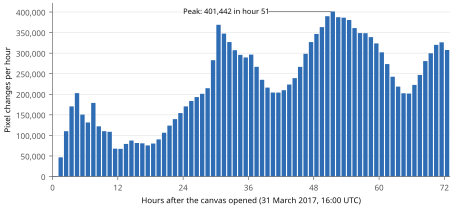
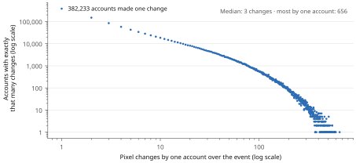
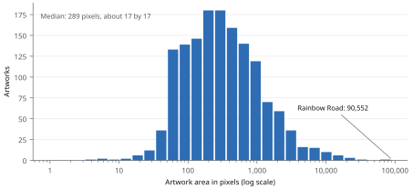
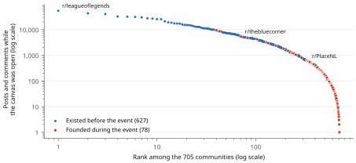

# The record in numbers

The dataset joins three public records of the 2017 event: Reddit's log of every pixel change, the Place Atlas of the finished canvas, and the posts and comments of the subreddits behind its artworks. This page shows what each holds. Every figure is computed from the shared files; the [data guide](sources/data-README.html) explains how to download and rebuild them.

## Pixel changes

Reddit's log records the time, position, colour and hashed account of every change: 16,559,897 changes by 1,166,924 accounts (Reddit, 2017). The canvas opened on 31 March 2017 at 16:00 UTC and froze 72 hours later. Activity rose and fell with the day: it dipped between about 04:00 and 12:00 UTC, and peaked in hour 51 at 401,442 changes.

<figure class="data-figure"><figcaption>Pixel changes per hour over the 72 hours. 391 test changes by 18 accounts before the opening are left out.</figcaption></figure>

Most accounts did little. The median account made 3 changes, and a third of all accounts (382,233) made just one. The most active account made 656; the five-minute timer allowed about 876 over the event. The top 10% of accounts made 60% of all changes, and the top 1% made 15%.

<figure class="data-figure"><figcaption>Accounts by the number of pixel changes each made. Both axes are on a log scale.</figcaption></figure>

## Artworks

The Place Atlas outlines 1,473 artworks on the finished canvas (Place Atlas, 2017). The median artwork covers 289 pixels, about 17 by 17; one in ten covers more than 1,763. The largest, Rainbow Road, covers 90,552 pixels, 9% of the canvas, and drew 1,130,384 changes. The Entire Dutch Area follows at 33,760 pixels. The median artwork drew 3,368 changes, or about 12 per pixel: most pixels were placed, overwritten and placed again.

<figure class="data-figure"><figcaption>Artworks by area. The horizontal axis is on a log scale.</figcaption></figure>

Of the 1,473 artworks, 1,236 credit at least one subreddit. These credits are where the census of communities starts ([how we came to 705](census.html)).

## Communities

The 705 communities in the census wrote 2,130,302 posts and comments from the opening to a day after the freeze, 1,590,890 of them while the canvas was open. Sizes span four orders of magnitude. The median community wrote 549 posts and comments while the canvas was open; r/leagueoflegends wrote 54,110, most of them about its game rather than the canvas. The coders read every item and coded what concerned the event.

<figure class="data-figure"><figcaption>The 705 communities ranked by their posts and comments while the canvas was open. Both axes are on a log scale. Red dots mark the 78 communities whose first record falls during the event.</figcaption></figure>

The week before the event shows who was already there. The median community had 276 distinct posters in those seven days. 78 communities have no record before the event: they were founded for it. [New communities](emergence.html) says what they were.

Writing and placing were done by different people. Across the 704 communities with an artwork region, a median of 11% of the changes inside the community's artworks came from accounts that posted in the community between the opening and seven days after the freeze. Most hands that built an artwork left no post in the community that claimed it. Regions overlap, so these shares are sound for each community but cannot be added across communities.

## Sources

Every number on this page comes from `pixel_record.npz` and `artworks_index.csv` (the pixels-per-artwork build), `MASTER-census.csv` (the census) and the hourly pixel table `pixels.csv` with its week-before activity table. All are rebuilt by the [collection scripts](sources/data-README.html).

Place Atlas. (2017). *atlas-2017* [Data set]. GitHub. https://github.com/placeAtlas/atlas-2017

Reddit. (2017). Place datasets [Data set]. r/redditdata.
