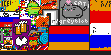
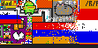
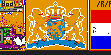
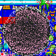
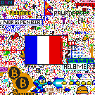
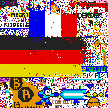
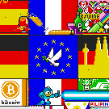

# Three conflicts on the canvas

On the same canvas, one group lost its flag, another rebuilt its logo, and two rival flags acquired a shared emblem. The images show what changed. The discussions show what participants asked each other to do.

Times on the canvas are in UTC.

## The Armenian flag and the Dutch lion

The Armenian tricolour and GreyBlob’s cat shared a border. When r/cirkeltrek published plans for a Dutch lion on the same patch, some Dutch participants tried to honour agreements with their neighbours while others called for annexation. Within hours, the coat of arms covered both drawings. After one failed move, r/armenia reported rebuilding above the Indian flag with its neighbours’ permission.

 2 Apr, 06:17 UTC. Flag and cat.

 2 Apr, 13:30 UTC. Orange pixels spread.

 2 Apr, 16:40 UTC. The coat of arms.

[The Dutch plan](https://www.reddit.com/r/cirkeltrek/comments/62yut5/) · [GreyBlob’s warning](https://www.reddit.com/r/greyblob/comments/62z2mj/) · [Armenia’s new site](https://www.reddit.com/r/armenia/comments/62y7ms/_/dfqhli0/) · [Replay the Dutch area](results/placenl-record.html#dutch-replay)

## The Void attacks the osu! logo

The pink circle near the bottom of the canvas belonged to fans of osu!, a rhythm game. On 2 April, participants in r/theblackvoid picked the logo as a place to start a new patch of black pixels. Others in the same group objected that it was too far from their main patch. Black pixels spread over the circle. Defenders restored the pink field and white lettering by noon, and had to defend them again later.

 2 Apr, 03:00 UTC. The pink logo.

 2 Apr, 06:00 UTC. The letters disappear.

 2 Apr, 12:00 UTC. The logo returns.

[The call to attack](https://www.reddit.com/r/theblackvoid/comments/62xoa2/) · [An objection from the Void](https://www.reddit.com/r/theblackvoid/comments/62xx10/) · [A defender’s account](https://www.reddit.com/r/osugame/comments/6383m6/_/dft5k8g/)

## An EU flag where the French and German flags crossed

At 07:55 UTC on 1 April, someone in r/de proposed a European flag where the French and German tricolours would meet. Two hours later another thread called for annexation. It drew 648 replies in the study window. As German stripes crossed the French flag, French participants kept circulating the proposal for a shared design. At the close, a white dove and a ring of stars marked the crossing.

 1 Apr, 11:00 UTC. The flags approach.

 1 Apr, 15:00 UTC. German stripes cross.

 3 Apr, 16:58 UTC. The shared design.

[The proposal in r/de](https://www.reddit.com/r/de/comments/62rfih/) · [The annexation thread](https://www.reddit.com/r/de/comments/62rvfj/) · [The proposal in r/france](https://www.reddit.com/r/france/comments/62r9qu/_/dfp4hhv/) · [Reporting at the close](https://arstechnica.com/gaming/2017/04/in-memoriam-reddits-72-hour-live-graffiti-wall-as-a-social-experiment/)

## How the images were made

The Armenian sequence comes from a reconstruction that follows the same patch in 14 frames and traces the conflict through 59 threads. The other two sequences use timed crops from the 2017 canvas archive. Within the osu! and EU artwork outlines, we checked those crops against the study’s pixel log. Each strip holds the location fixed. All times are UTC.

[2017 canvas archive](https://github.com/emilyalbini/reddit-place-2017/tree/0182da3ca57d02ba4a4fbd2ec49fbacc7397376d) · [How to rebuild the pixel record](sources/data-README.html) · [The record in numbers](data.html)
