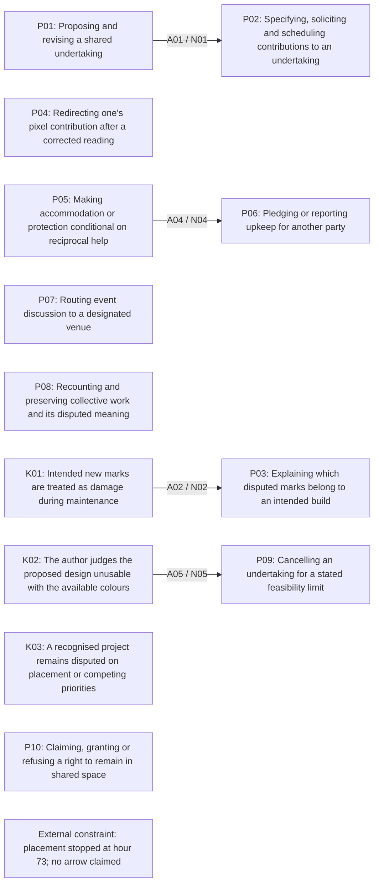
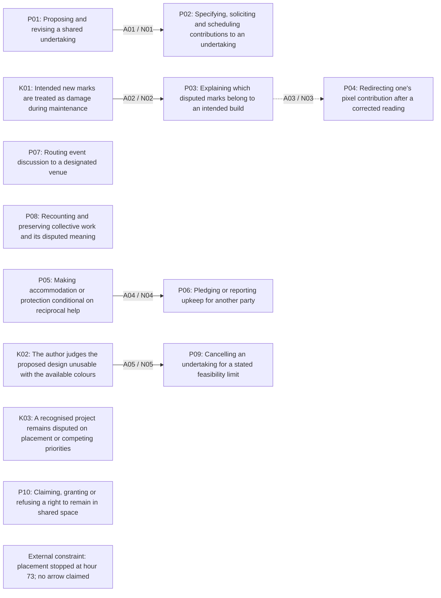

# Model figure and source specification

Target length: under 1,800 words, excluding the diagrams and quoted evidence.

## Source-bound drawing

The controller generated model.png and data-structure.html from render version 1062a2d4df1f8fefda86ffffb3abff325b5cb1babea132aa26c16b06c91b6e69. I inspected the native PNG and read the table source through the gateway. The PNG shows the standing nodes, tagged arrows and disconnected objects correctly. Its layout groups unconnected objects to the left; position alone has no causal meaning.

The native renderer exposes one image, with the retained conjectural relation dashed. It does not annotate hour 73. The textual figure specifications below add that external annotation and define both views. They do not add a model element, arrow or analytical pass. The native PNG alone is therefore incomplete as a clock-annotated figure; read it with this source specification.

## Without the conjectural relation

This view removes `A03` because `N03` rests wholly on a reading-alone interpretation. It does not withdraw the standing local interpretation from the model. All standing elements stay visible, including disconnected ones. `A06` is absent because it has no supporting route-to-pixel instance.

## With the retained conjectural relation

The dashed `A03` joins the explanation attempt to the local reported switch; it is not an established effect of a particular message. `N06` states the excluded `A06` hypothesis in propositions.jsonl, but it remains undrawn in both views because no instance supports it.

## Boxes, paths and source instances

The node statements come verbatim from model/elements.jsonl. `P01` and `P02` concern undertaking and contribution specification. `K01`, `P03` and `P04` distinguish mistaken maintenance, explanation and local reported redirection. `K03` preserves deliberate dissent beside that path. The accommodation path is `P05` to `P06`; the feasibility path is `K02` to `P09`. Permission `P10`, discussion routing `P07` and event accounting `P08` have no invented effects.

`A01` / `N01`: `P01` to `P02`, order, codes-read, fair. The specified time gives a contributor a definite promise to make. Primary call "OPERATION LILLA BÄLT - VI SLÅR TILL KLOCKAN 16" (`c0144`, A82cS84xihPyp633kXbBVezOPIg=, hour 19.795, item `62s8z5`, thread `62s8z5`, offsets 0:46; cite 9662) and response "Klart man ställer upp! Sätter alarm strax innan 16:00!" (`c0146`, PMTSUaECngOCtW7asKKEqX7do7U=, hour 20.03472222222222, item `dfotweb`, thread `62s8z5`, offsets 0:54; cite 9664) are distinct speakers. No execution effect is drawn.

`A02` / `N02`: `K01` to `P03`, order, codes-read, fair. The report "Folk håller på att ta bort." (`c0702`, qRhBg6YkZPC35/sSCSxMlStdX8o=, hour 68.13388888888889, item `dfrmdw6`, thread `636a8n`, offsets 0:27; cite 9694) meets the advocate's stated reason "Därför detta delades till Sweddit så att så många som möjligt ser." (`c0703`, bpRX1cjAPncuHeF3DACQ8OhcGWU=, hour 68.14888888888889, item `dfrmesy`, thread `636a8n`, offsets 0:66; cite 9696) This is an explanation attempt, with no exposure or agreement claim.

`A03` / `N03`: `P03` to `P04`, transition, reading-alone, fair in the standing model, conjectural as a proposition. The local report is "Började bygga blått på det där, hjälper till nu istället!" (`c0709`, 3bfpkAVUXTH6WuKOgZcSzmKKny8=, hour 68.29, item `dfrmo45`, thread `636a8n`, offsets 0:57; cite 9702) The exact message is unknown. Arch's reported decision with continued removal (`c0403`) and horse objections (`c0707`, `c0713`) prevent generalising this path to approval-to-compliance.

`A04` / `N04`: `P05` to `P06`, order, codes-read, fair. The terms "We needed some loyal allies from their timezone to help us repair when we are asleep, so we let the Maryland flag stay on ours for protection if they help repair our flag." (`c0588`, fPYLXGntqtV9TX/gkL2GpUdrrsE=, hour 54.550555555555555, item `dfqty7u`, thread `631vz6`, offsets 0:171; cite 9753) are followed by "Reporting from r/Maryland here- will devote my pixels to defending r/Sweden during the dark hours! Sverige !!!" (`c0589`, +43IMXXoPoJtcQFa6bfYrbGTbrY=, hour 54.75333333333333, item `dfquj36`, thread `631vz6`, offsets 0:110; cite 9686) A further report `c0590` describes current cleaning in `631vz6`. These are statements of obligation and work, not independent observation of performance.

`A05` / `N05`: `K02` to `P09`, transition, codes-read, thin. The single edited statement supplies both judged limit and cancellation: "Jag gjorde fel på ritningen med antalet färger. Kan inte få det snyggt med dom färger som finns. Lika bra att avbryta. Förlåt alla, misslyckades totalt här." (`c0436`, ut241QgoFq54FMpzwUgOcT3v/Pc=, hour 45.38388888888889, item `dfq6cku`, thread `62zhrg`, offsets 145:301; cite 9678) Its edit time is unknown. No interval is inferred from the creation timestamp.

All instances are from r/sweden. There is no arrow frequency estimate, community denominator or measured baseline result. The registered episode samples concern the limits of each relation, not counts of communities solving a problem.

## External boundary and omissions

The hour-73 box is an imposed platform constraint, with no causal arrow. Placement becomes unavailable then; later `P01` and `P02` can concern room artifacts while `P08` recounts the event. The diagram supplies no gratitude-to-new-work link, no completed feedback cycle and no `P10` permission-to-compliance link. The speculative venue link remains outside both drawn views.

The drawing does not show every code, ordinary room activity, unresolved fragments, silent labour or off-platform decisions. It cannot portray the compact calls, martial register and uneven presumed knowledge that form_pass.md keeps at turn level. The structure table preserves all coder parents and the ungrouped `T4-005`; no missing line should be supplied merely to connect the graph.
