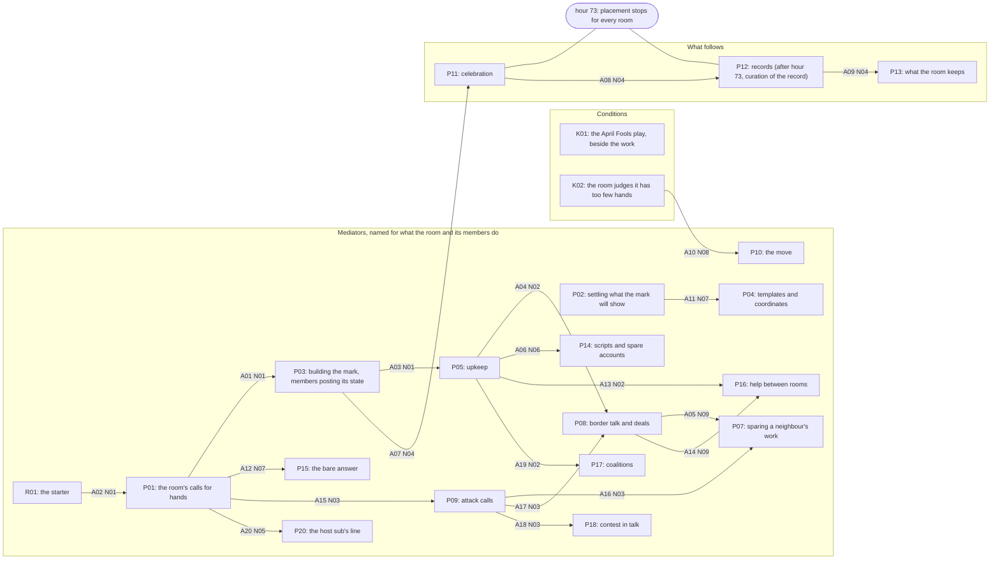
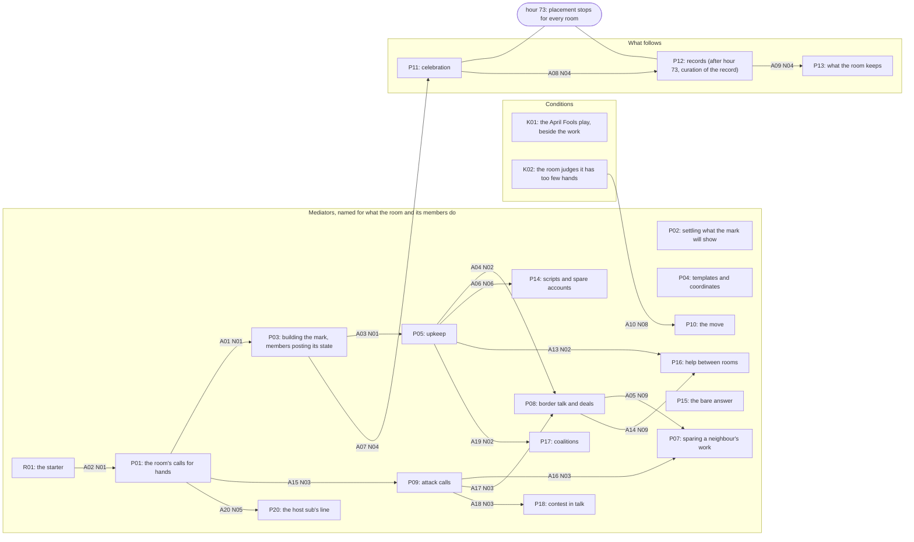

# The figure (C5c-13, final; C5d's work redone after the serial work)

Target length: about 1,800 words with the drawings. The model as it stands after pass 15, drawn once with the theorised arrows and once without. `gen_views.py` also draws the model into `_views/figure-model.md` at every close. Every box and arrow is named by id. Each arrow carries the proposition (N01 to N09, in `propositions.jsonl`) that carries it. An arrow no proposition carries is not drawn. The figure drawn at C5d, before the serial work, is kept as `figure-C5-p14.md`.

## The count at the top

The figure shows all 23 standing elements. Twenty-one are boxes: the 20 elements the arrows join, and K01, which carries no arrow. The two claims, C01 and C02, sit beside the figure. Section 4 set the count: the cuts left 23 standing elements, and 21 boxes in three columns can be taken in at one pass. The middle column is the widest, so the figure is a model of mediators, not a two-column lattice. Where a box names the room, the room is the actor because its members spoke or acted for it.

## The boxes, in three columns

- **Conditions (left):** K01 the April Fools play, beside the work; K02 the room judges it has too few hands.
- **Mediators, named for what the room and its members do (middle):** R01 the starter; P01 the room's calls for hands; P02 settling what the mark will show; P03 building the mark, members posting its state; P04 templates and coordinates; P05 upkeep; P07 sparing a neighbour's work; P08 border talk and deals; P09 attack calls; P10 the move; P14 scripts and spare accounts; P15 the bare answer; P16 help between rooms; P17 coalitions; P18 contest in talk; P20 the host sub's line.
- **What follows (right):** P11 celebration; P12 records (after hour 73, curation of the record); P13 what the room keeps.
- **The terminus:** a bar at hour 73 crosses the right column. Placement stopped there for every room. P11 and P12 sit on both sides of it; P13 and the curation of the record sit near it and after it.
- **Beside the figure, not boxes:** C01, a decided element of order, coded in 46 of 705 rooms (F-006); and C02, a tie the room had before the canvas that names the rival, untested for order (F-013). Neither carries an arrow.
- **K01 is a box with no arrow.** The model claims no effect of the April Fools play; F-009's held-size test found no delay of the work.

## The arrows

Each line gives the arrow, its proposition, its strength, what it is grounded in, its count and one instance. The grounding is the coders' cited concepts read for order: the rooms where the first concept of one element comes before the first of the other, of the rooms carrying both, against a null of 500 shuffles within each room. A transition is a reply in the same thread, by another author, carrying the second element after the first. Of the 20 arrows drawn, 19 are shown by an audited transition and 1 by a quote.

- **A01** P01 to P03, N01; fair; order; 81 of 126 rooms (0.643; null 95th percentile 0.571), beats its null. Instance (transition): metroid/c0001 to c0002 (h4.27 to h4.29).
- **A02** R01 to P01, N01; fair; order; 64 of 89 rooms (0.719; null 95th percentile 0.539), beats its null. Instance (transition): opticgaming/c0191 to c0192 (h6.43 to h6.45).
- **A03** P03 to P05, N01; strong; order; 148 of 190 rooms (0.779; null 95th percentile 0.389), beats its null. Instance (transition): monsterhunter/c0082 to c0083 (h35.63 to h35.64).
- **A04** P05 to P08, N02; fair; order; 235 of 401 rooms (0.586; null 95th percentile 0.539), beats its null. Instance (transition): unturned/c0059 to c0060 (h40.70 to h41.58).
- **A05** P08 to P07, N09; thin; order; 106 of 158 rooms (0.671; null 95th percentile 0.658), beats its null. Instance (transition): asktransgender/c0003 to c0004 (h23.94 to h23.98). Its order beats the null; its mechanism is theorised (F-020).
- **A06** P05 to P14, N06; strong; order; 160 of 203 rooms (0.788; null 95th percentile 0.655), beats its null. Instance (transition): TheFarLeftSide/c0384 to c0385 (h54.56 to h54.61).
- **A07** P03 to P11, N04; strong; order; 139 of 182 rooms (0.764; null 95th percentile 0.434), beats its null. Instance (transition): suomi/c0097 to c0098 (h22.94 to h23.23).
- **A08** P11 to P12, N04; strong; order; 225 of 289 rooms (0.779; null 95th percentile 0.609), beats its null. Instance (transition): lakers/c0226 to c0227 (h81.10 to h81.12).
- **A09** P12 to P13, N04; fair; order; 113 of 145 rooms (0.779; null 95th percentile 0.628), beats its null. Instance (transition): uiuc/c0154 to c0155 (h75.63 to h76.39).
- **A10** K02 to P10, N08; thin; order; 11 of 21 rooms (0.524; null 95th percentile 0.429), beats its null. Instance (quote): paranatural/c0020: 'Seems like we lost the spot, unfortunately :( Guess we're a little too small to make this work, couldn't build fast enough.'.
- **A11** P02 to P04, N07; thin; transition; 111 of 185 rooms (0.600; null 95th percentile 0.670), does not beat its null. Instance (transition): udub/c0008 to c0009 (h55.02 to h55.09). Theorised.
- **A12** P01 to P15, N07; thin; transition; a transition in 3 rooms; no order count. Instance (transition): DestinyTheGame/c0002 to c0008 (h3.03 to h3.91). Theorised.
- **A13** P05 to P16, N02; fair; order; 171 of 240 rooms (0.713; null 95th percentile 0.642), beats its null. Instance (transition): aceattorney/c0049 to c0050 (h38.35 to h38.37).
- **A14** P08 to P16, N09; thin; order; 138 of 214 rooms (0.645; null 95th percentile 0.636), beats its null. Instance (transition): littlewitchacademia/c0049 to c0051 (h62.87 to h62.90).
- **A15** P01 to P09, N03; strong; order; 93 of 129 rooms (0.721; null 95th percentile 0.550), beats its null. Instance (transition): Temple/c0005 to c0007 (h35.07 to h35.13).
- **A16** P09 to P07, N03; strong; order; 82 of 104 rooms (0.788; null 95th percentile 0.606), beats its null. Instance (transition): nyjets/c0086 to c0087 (h47.85 to h47.87).
- **A17** P09 to P08, N03; fair; order; 95 of 172 rooms (0.552; null 95th percentile 0.477), beats its null. Instance (transition): czech/c0151 to c0153 (h50.66 to h50.73).
- **A18** P09 to P18, N03; fair; order; 56 of 68 rooms (0.824; null 95th percentile 0.676), beats its null. Instance (transition): rpi/c0024 to c0026 (h55.46 to h55.56).
- **A19** P05 to P17, N02; thin; order; 87 of 121 rooms (0.719; null 95th percentile 0.678), beats its null. Instance (transition): criticalrole/c0057 to c0058 (h57.74 to h57.80).
- **A20** P01 to P20, N05; strong; order; 132 of 155 rooms (0.852; null 95th percentile 0.594), beats its null. Instance (transition): nintendo/c0120 to c0121 (h35.97 to h36.25).

## Drawing 1, with the theorised arrows (20 arrows)

## Drawing 2, without them (18 arrows)

The same, less A11 and A12. P02, P04 and P15 then stand with no arrow.

## Loops

None is drawn. `model/loops.jsonl` records 0 dated cycles. No room's record runs a whole cycle, and no counted arrow runs from the move (P10) back to building (P03).

## What the figure leaves out

It leaves out the field's tentative arrow from P08 to P21, which no proposition carries. It also leaves out the tentative elements P21 and P22, and the candidates P06, R02, K03, K04 and P19. Seven fourth-order themes are used by no element and are not drawn: T4-003 Sensemaking; T4-010 Backstage decision-making; T4-014 Territoriality; T4-019 Attribution; T4-023 Neo-tribes; T4-024 Symbolic boundaries; T4-025 Visibility returns. Two third-order themes no fourth-order theme gathers are not drawn either: ordinary sub talk (T3-017) and a hacked sub (T3-133). It does not draw giving the work up, the other outcome after doubt and a loss (11 rooms against 10 that moved; F-019), since no element names it. The figure also leaves out the register the coders' topic-based tier scattered: the room's own world used to do the canvas work (a game, a crusade, a mock state). The scheme split that register across in-jokes, fandom lore, national history and the work itself. Finally, the figure does not show the rooms the account names as told only in part.
