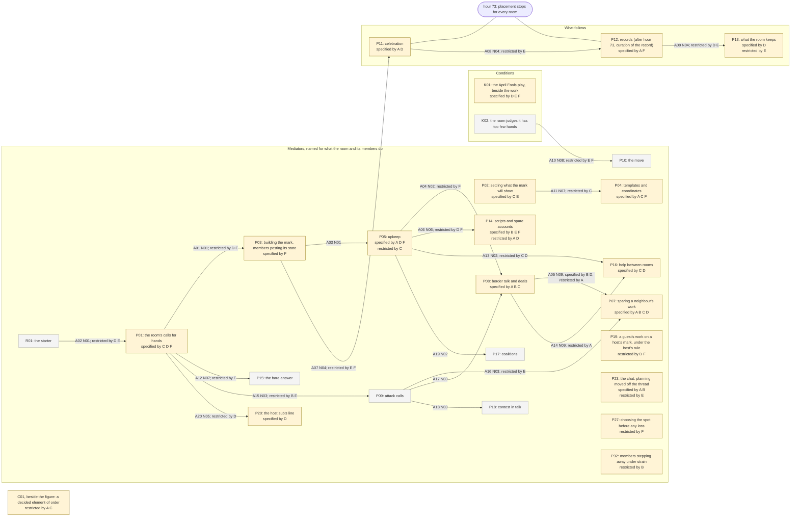

# The figure: the model with its forms inside it

Drawn at D6b from `fractal-forms-D6.jsonl` by `_analysis/d6b_figure.py`. It is the stage C5 figure (`figure-C5.md`, drawing 1: 21 boxes, 20 arrows, each arrow with the proposition that carries it) with the six room forms drawn into its boxes and arrows, at the level where they differ: the element or arrow. Each box and arrow names the forms that specify it (add detail that holds in their rooms) or restrict it (it holds there only under a condition). A box with no form named is held by every form as the model states it. Four elements outside the C5 drawing are added because a form changes them (P19, P23, P27, P32); the claim C01 stands beside the figure, as at C5. No form replaces any element. The unvalidated proposals (`proposals-D6.jsonl`) are not drawn.

## The forms

- **A, Border terms and the announced plan**: changes 11 of the 66 units (elements and arrows) read.
- **B, Behind the thread: chat, scripts, raids**: changes 7 of the 66 units (elements and arrows) read.
- **C, The design reopened**: changes 10 of the 66 units (elements and arrows) read.
- **D, Keeping, with help or carrying on**: changes 17 of the 66 units (elements and arrows) read.
- **E, The sub's play, run as work**: changes 13 of the 66 units (elements and arrows) read.
- **F, Moving for the spot**: changes 14 of the 66 units (elements and arrows) read.

Units read: 66 (each with six form lines, 396 lines in all); lines that specify 37, restrict 35, replace 0, leave untouched 324.

## Drawing 1, the model with the forms in its boxes and arrows

## Legend

- **Boxes.** Left, the conditions; middle, what the room and its members do; right, what follows the work. The bar at hour 73 marks the close. Shaded boxes are changed by at least one form; grey boxes by none.
- **specified by X**: in form X, add-step, add-condition or link lines on the unit lean (held by at least the larger of 5 and a tenth of X's defining rooms, at 1.2 times the 558 defining rooms' share or more). **restricted by X**: restrict lines lean and outnumber the other leaning ops. The rule was logged at D6a-01 before it ran (`_analysis/d6_fractal.py`).
- **Arrows.** Each keeps its C5 label: its id and the proposition (N01 to N09) that carries it, then the forms that specify or restrict it. Of the 20 arrows, one is specified by a form (A05, by B and D), and 16 are restricted by one or more. A restriction says the order holds in that form only under a condition, or that the record there cannot show it.
- **Forms.** A to F are the six room forms of D4a-08c, by their final names (`room-forms-names.md`). B is a grouping, not one shared change. The 35 branches are the level below and are not drawn; the table names the branches that explain each form's changes (`fractal-D6.jsonl`).

## Where each form differs, with the branches that explain it

| form | specifies | restricts | branches with a line in this form (`fractal-D6.jsonl`) |
|---|---|---|---|
| A, Border terms and the announced plan | P04, P05, P07, P08, P11, P12, P23 | A05, A14, C01, P14 | F10, F15, F17, F18, F19, F26, F28, F30, F31, F32 |
| B, Behind the thread: chat, scripts, raids | A05, P07, P08, P14, P23 | A15, P32 | F08, F16, F20, F29 |
| C, The design reopened | P01, P02, P04, P07, P08, P16 | A11, A13, C01, P05 | F07, F33, F34 |
| D, Keeping, with help or carrying on | A05, K01, P01, P05, P07, P11, P13, P16, P20 | A01, A02, A06, A09, A13, A20, P14, P19 | F04, F11, F12, F13, F14, F18, F22, F23, F24, F27 |
| E, The sub's play, run as work | K01, P02, P14 | A01, A02, A07, A08, A09, A10, A15, A16, P13, P23 | F01, F02, F03, F04, F05, F06, F21, F25, F34, F35 |
| F, Moving for the spot | K01, P01, P03, P04, P05, P12, P14 | A04, A06, A07, A10, A12, P19, P27 | F04, F08, F09 |

**Held by every form as the model states it (31 units):** A03, A17, A18, A19, A21, C02, K02, K03, K04, K05, K06, K07, P06, P09, P10, P15, P17, P18, P21, P22, P24, P25, P26, P28, P29, P30, P31, P33, P34, R01, R02.

## What the figure leaves out

It leaves out what the C5 figure left out (its last section), the eleven unvalidated proposals, the two held proposals (QD4-001; stated in full in `retelling-D6.md`), and the rates at which the forms hold an element without changing it, which the rule does not test (told in the retelling under D05 and D08). It does not draw the branches, the splits of form D, or the survival reading by form, which the retelling gives in words.
