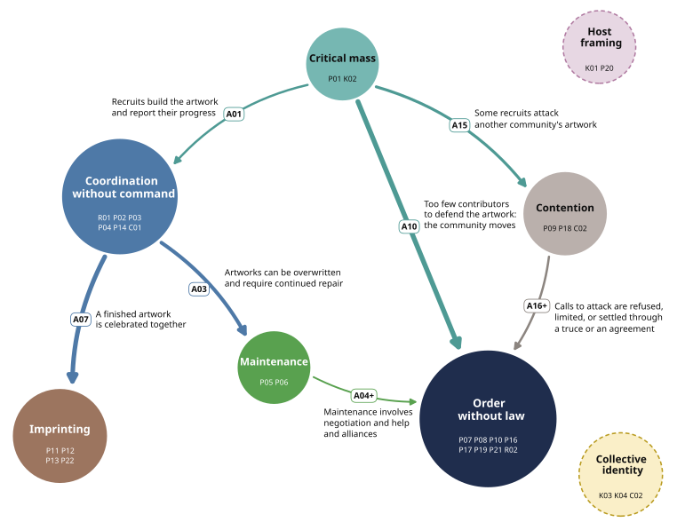

# Findings

What the completed run found, and the records behind each claim.

## What the run found

Three findings stand out so far. Each is stated as the papers state it, with its evidence and its limit. The current model's insights are not settled.

**Four roles.** From our preliminary findings, we observe that recruitment, coordination, maintenance and relations with neighbors form distinctive roles in how communities organize. Evidence: [the eight dimensions](results/population-aggregation.html#eight-aggregate-dimensions) and [the model's account](results/population-aggregation.html#the-population-model-and-its-account). Limit: the same agents produced the coding and assessed fit, so the fit results are an internal check.

**Repair erases a planned change.** An initial iteration of the population model stated that communities keep their work by repairing changed pixels. The coder of r/PlaceNL objected with its community's record: its own defense script kept erasing the canal houses members had agreed to build. The aggregator found similar evidence in 67 communities and revised the model: repair restores the form the keepers know, so a planned change is erased as damage until the keepers learn of it. Evidence: [r/PlaceNL's return](results/placenl-return.html#repair-and-change) and [the return for all 705](results/population-return.html). Limit: the 67 is the aggregator's reading of the coders' returns; human audits can test selected cross-case inferences.

**Little formal authority.** Few communities show a clear signal of authority, such as a leader, a vote, an oath, a sanction or a division of work. The coders found one in 44 of the 705 communities while coding, and in about 119 when the returned model asked the community coders to check explicitly for it. Evidence: [decided order](results/population-aggregation.html#decided-order). Limit: these indicators describe different arrangements and do not form a single measure of formal authority.

<figure class="data-figure"><figcaption>Figure 2 of the Technical Appendix: the population model after the return, across eight aggregate dimensions. <a href="results/population-aggregation.html#the-population-model-and-its-account">Read the model and its account</a>.</figcaption></figure>

The two journeys below take one community and then all 705 through the same parts of the study.

## One community: r/PlaceNL

One community, part by part: r/PlaceNL, founded for the event to coordinate the Dutch artworks.

- [The record: r/PlaceNL](results/placenl-record.html): the Dutch area, hour by hour. r/PlaceNL joined it on the second day, and most hands that built it left no post in the community.
- [Community coding: r/PlaceNL](results/placenl-coding.html): one community coder and two fleet coders turn its 701 posts and comments into 246 codes, 21 themes and a case account; the same coder later builds a local model.
- [Aggregation: r/PlaceNL](results/placenl-aggregation.html): the aggregator reads the coder's work, writes a note on the community and places each theme in the population's coding structure.
- [The return: r/PlaceNL](results/placenl-return.html): the model goes back to r/PlaceNL's coder, who reports canal houses erased by the community's own defense script. Corrections from other communities revise the model's account of repair, and r/PlaceNL's line becomes a specification of the revised claim.
- [Organizational forms: r/PlaceNL](results/placenl-forms.html): r/PlaceNL falls in form B, Behind the thread, and departs from it in places.

## The population model

All 705 communities, through the same parts.

- [The record: 705 communities](results/population-record.html): of the 777 subreddits credited with an artwork, 705 stay, because their members wrote about the event while the canvas was open.
- [Community coding: 705 communities](results/population-coding.html): each community is read by its own community coder: 115,388 first-order codes and 7,844 second-order themes.
- [Aggregation: 705 communities](results/population-aggregation.html), A1 to C5: the aggregator composes the coders' work into 197 third-order themes, 28 fourth-order themes, eight aggregate dimensions and one model of how organizing unfolds.
- [The return: 705 communities](results/population-return.html), D1 to D3: every community coder answers the model, and the aggregator rules on each change and revises it.
- [Organizational forms: 705 communities](results/population-forms.html), D4 to E2: communities that asked for similar changes form six candidate organizational forms; the aggregator audits the run and reviews how it was handled.

## Time and costs

How long each part of the study took and what it consumed: 71 days, from the first community coding run under an earlier contract, on 18 August, to the last aggregator session on 28 October.

- [The study in five numbers](time.html): all the work used 51.82 billion tokens, worth $20,497 at list prices; $68 was paid in cash, to DeepSeek.
- [By part of the work](time.html#by-part-of-the-work): community coding used 15.74 billion tokens and the aggregator 21.45 billion; the return, the re-check, the independent readers and the r/place subreddit used the rest.
- [The aggregator](time.html#the-aggregator): 21.5 days in 314 sessions, from 6 to 28 October; it worked 10.3 of those days, and the usage limits of the Claude subscription took 3.9.
- [Prices used](time.html#prices-used): each model's published price per billion tokens, and the work not counted.
